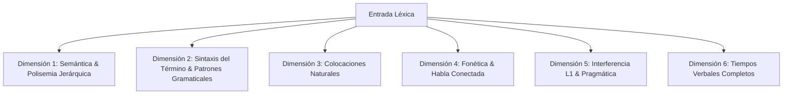

# Requisitos Funcionales: Banco de Vocabulario y Expresiones

## 1. Propósito del Módulo
Proporcionar una biblioteca léxica integral y pedagógicamente optimizada que combine un corpus esencial precargado de alta frecuencia (3.000 a 5.000 términos) con una bóveda personal expandible. 

Su objetivo primordial es estructurar el **conocimiento declarativo** (significado, pronunciación, gramática) y el **conocimiento práctico** (patrones de combinación sintáctica, colocaciones, comportamiento en contexto) para afianzar y automatizar posteriormente el **conocimiento procedimental** (producción espontánea, fluida e idiomática del usuario al hablar y redactar sin traducción mental).

---

## 2. Tipología de Unidades Léxicas (*Lexical Units*)

El sistema no concibe el léxico como simples palabras aisladas, sino que cataloga y modela tres tipos de unidades operativas:

1. **Lemas Simples (*Single Words*)**:
   * Palabras individuales con identidad morfológica (*achieve, reluctant, thrive, run*).
2. **Unidades Fraseológicas Multipalabra (*Lexical Chunks & Multi-Word Units*)**:
   * Bloques léxicos fijos o semifijos que el cerebro procesa y recupera como unidades holísticas:
     * **Verbos Frasales (*Phrasal Verbs*)**: Unidades verbo + partícula (*give up, look after, run out of*).
     * **Modismos / Idioms**: Expresiones idiomáticas con significado no composicional (*bite the bullet, once in a blue moon*).
     * **Binomios Léxicos**: Pares coordinados fijos (*ups and downs, safe and sound, give and take*).
     * **Marcos Oracionales (*Sentence Frames / Stems*)**: Plantillas conectivas para estructurar discursos (*as far as I am concerned...*, *the main reason why... is that*).
3. **Colocaciones Naturales Asociadas (*Collocations*)**:
   * Combinaciones de coaparición probabilística alta vinculadas a los lemas (ej. *make a decision*, *heavy rain*, *deeply concerned*).

---

## 3. Requisitos de Estructura y Corpus (Modelo Híbrido)

* **RF-VOC-01: Arquitectura Híbrida (Corpus Esencial + Bóveda Personal)**:
  * El sistema no debe partir de un lienzo en blanco dependiente de la carga manual del usuario. Debe incorporar:
    * **Corpus Esencial Pre-cargado (Core Corpus)**:
      * Base de datos local precargada con 3.000 a 5.000 lemas de alta frecuencia (basada en listas estandarizadas como *Oxford 3000/5000* y *NGSL*).
      * El enriquecimiento de las dimensiones pedagógicas de todo el corpus precargado se realiza a través del **Motor de Ingesta y Generación por IA** ([`07_vocab_ai_generation_engine.md`](file:///c:/Users/Josnaiker%20Rivas/Desktop/english_learning_assistant/docs/02_functional_specs/07_vocab_ai_generation_engine.md)), garantizando precisión léxica nativa, colocaciones auténticas y oraciones graduadas.
      * Cada lema debe estar catalogado por banda de frecuencia (`TOP_500`, `TOP_1000`, `TOP_3000`, `TOP_5000`) y nivel del MCER (A1 a C1).
      * Estado inicial predeterminado: `Inactivo / Por Activar`. El usuario o la ruta de aprendizaje activa términos por bloques o metas temáticas sin saturar el mazo de estudio.
    * **Bóveda Personal (Personal Vault)**:
      * Permite al usuario consultar e incorporar términos libres, vocabulario técnico de su especialidad, expresiones descubiertas en lecturas o lemas asistidos por IA.
      * Si el término buscado ya existe en el Corpus Esencial, el sistema lo activa directamente; si no existe, la IA genera su ficha estructurada validada con las dimensiones pedagógicas completas.

* **RF-VOC-02: Búsqueda Local Instantánea y Sugerencias de Autocompletado**:
  * La consulta de términos del corpus precargado debe ser local e instantánea (sin latencia de red ni consumo de tokens de IA).
  * Debe ofrecer autocompletado inteligente a partir de los primeros 2 o 3 caracteres ingresados, indexando tanto lemas simples como chunks y phrasal verbs.

---

## 4. Dimensiones del Modelo Pedagógico del Término

Cada entrada del banco debe documentarse y estructurarse a través de las siguientes dimensiones para garantizar la transición hacia el dominio procedimental:

### Dimensión 1: Semántica y Manejo de la Polisemia
* **RF-VOC-03: Desglose Jerárquico de Acepciones y Claves Contextuales**:
  * **Presentación Jerárquica**: Las acepciones se ordenan por frecuencia real de uso. Las acepciones arcaicas o infrecuentes permanecen ocultas en paneles secundarios.
  * **Nivel MCER por Acepción**: Cada sentido cuenta con su nivel específico (ej. *run* [físico] es A1; *run a business* es B2).
  * **Clave Contextual de Desambiguación (*Contextual Hint*)**: Cada acepción debe tener una pista contextual obligatoria para evitar ambigüedades durante la recuperación mental (ej. para *run*: *"run a business"* [administrar] frente a *"run 5 miles"* [correr]).
  * **Definición en "Learner English"**: Redactada en inglés simple (usando el vocabulario definitorio estandarizado), evitando tecnicismos abstractos.
  * **Traducción Focalizada**: Traducción exacta y natural al español correspondiente a *esa acepción específica*, no una lista inconexa de sinónimos.
  * **Activación Selectiva**: El usuario activa únicamente la acepción que desea estudiar, generando una tarjeta independiente en el SRS.

### Dimensión 2: Sintaxis del Término y Patrones Gramaticales
* **RF-VOC-04: Patrones de Complementación y Reglas Estructurales**:
  * **Patrones de Complementación Verbal**: Documentar explícitamente el régimen sintáctico para evitar errores estructurales en redacción:
    * Requisito de gerundio vs. infinitivo (ej. *admit doing sth* vs. *decide to do sth*).
    * Preposiciones dependientes ligadas a verbos, adjetivos y sustantivos (ej. *depend ON*, *interested IN*, *demand FOR*).
    * Estructuras de objeto indirecto (ej. *explain sth TO sb*, previniendo el error hispanohablante *\*explain me*).
  * **Tipología Rigurosa de Verbos Frasales (*Phrasal Verbs*)**:
    * *Tipo 1: Intransitivos* (sin objeto, ej. *wake up, show up*).
    * *Tipo 2: Transitivos Separables* (admiten separación del objeto, ej. *turn off the light* / *turn the light off*).
      * **Regla estricta del pronombre**: Alerta explícita de que los pronombres deben dividir la partícula obligatoriamente (*turn it off*, nunca *\*turn off it*).
    * *Tipo 3: Transitivos Inseparables* (el objeto siempre sigue a la partícula, ej. *look after sb*).
    * *Tipo 4: De Tres Partes / Preposicionales* (inseparables con dos partículas, ej. *look forward to, run out of*).
  * **Contabilidad de Sustantivos (*Countability*)**:
    * Marcado explícito de contable `[C]`, incontable `[U]` o cambio semántico según uso (*paper* [U, material] vs. *a paper* [C, artículo/periódico]).

### Dimensión 3: Colocaciones Naturales (*Collocations*)
* **RF-VOC-05: Red de Colocaciones Frecuentes**:
  * Para erradicar la traducción literal palabra por palabra, cada entrada debe incorporar de 2 a 4 colocaciones habituales catalogadas por tipo:
    * *Verbo + Sustantivo* (ej. *make a decision*, *pay attention*, *break a habit*).
    * *Adjetivo + Sustantivo* (ej. *heavy rain*, *crucial role*, *harsh reality*).
    * *Adverbio + Adjetivo* (ej. *deeply concerned*, *highly likely*, *utterly impossible*).
    * *Sustantivo + Preposición* (ej. *access to*, *increase in*).

### Dimensión 4: Fonética, Pronunciación y Fenómenos de Habla Conectada
* **RF-VOC-06: Fonética IPA Dual y Fenómenos Suprasegmentales**:
  * **Acentos Estándar (IPA US y UK)**: Transcripción fonética en General American (GA) y Received Pronunciation (RP) con marcas claras de acento prosódico primario (`ˈ`) y secundario (`ˌ`). Adaptado al acento preferido del usuario con alternancia en un clic.
  * **Formas Fuertes y Formas Débiles (*Strong vs. Weak Forms*)**:
    * Para palabras funcionales (preposiciones, conjunciones, pronombres, modales), registrar la forma débil con reducción vocálica a Schwa (/ə/) en habla conectada (ej. *can* aislado `/kæn/` vs. habla natural `/kən/`).
  * **Fonética Morfológica Crítica de Terminación *-ed***:
    * Para verbos regulares en pasado/participio, clasificar y resaltar explícitamente el alófono correspondiente (`/t/`, `/d/`, o `/ɪd/`) para eliminar el error fonético sistemático de los hispanohablantes (ej. *watched* `/t/`, *played* `/d/`, *decided* `/ɪd/`).
  * **Puntos de Habla Conectada (*Connected Speech*)**:
    * Identificación de enlaces consonante-vocal (*linking*, ej. *tur**n o**ff* $\rightarrow$ `/tɜːn‿ɒf/`), intrusión de semivocales (*glides* /j/, /w/) y pronunciación del *Flap T* (/ɾ/) en inglés americano.

### Dimensión 5: Interferencia de la L1 (Español) y Pragmática
* **RF-VOC-07: Falsos Amigos, Registro y Connotación**:
  * **Advertencia de Falsos Amigos (*False Friends / Cognates*)**:
    * Clasificación destacada (`is_false_friend`).
    * Explicación explícita de la trampa léxica (ej. *actually* $\rightarrow$ "en realidad / de hecho", no "actualmente").
    * Término alternativo recomendado para lo que el hispanohablante suele querer decir (ej. para "actualmente", usar *currently* o *at present*).
  * **Registro y Nivel de Formalidad**:
    * Clasificación del lema: *Formal*, *Informal / Coloquial*, *Neutro*, *Académico*, *Slang*.
    * Advertencias de uso para redacción (ej. evitar *kids* o *a lot of* en textos formales y sugerir *children* o *numerous/substantive*).
  * **Connotación**:
    * Identificación de carga positiva, neutra o negativa/peyorativa (ej. *slim* [positivo] frente a *skinny* [peyorativo]).

### Dimensión 6: Tiempos Verbales Completos
* **RF-VOC-08: Paradigma Temporal Completo para Todos los Verbos**:
  * Todo verbo catalogado en el banco (tanto **irregular** como **regular**) debe documentar de forma explícita y completa sus formas conjugadas principales:
    * **Forma Base / Infinitivo** (*Infinitive*, ej. *drive* / *walk*).
    * **Tercera Persona Singular del Presente Simple** (*Third Person Present*, ej. *drives* / *walks*).
    * **Pasado Simple** (*Past Simple*, ej. *drove* / *walked*).
    * **Participio Pasado** (*Past Participle*, ej. *driven* / *walked*).
    * **Gerundio / Participio Presente** (*Gerund / -ing form*, ej. *driving* / *walking*).
    * **Indicador de Irregularidad**: Flag explícito (`is_irregular: true/false`).
  *(Nota: Se excluyen intencionalmente del banco léxico árboles derivativos abstractos, familias de sustantivos/adjetivos o listas de antónimos morfológicos para mantener la carga cognitiva centrada exclusivamente en la competencia verbal y funcional).*

---

## 5. Oraciones de Ejemplo Graduadas y Contexto Auténtico

* **RF-VOC-09: Oraciones de Ejemplo Graduadas con Audio Neuronal**:
  * Cada acepción activa debe contar obligatoriamente con 2 oraciones de ejemplo auténticas:
    * **Ejemplo 1 (Nivel Accesible / Básico: A2-B1)**: Sintaxis directa (Sujeto + Verbo + Objeto), vocabulario de alta frecuencia, diseñado para la comprensión inmediata del sentido central.
    * **Ejemplo 2 (Nivel Natural / Avanzado: B2-C1)**: Sintaxis más compleja, integrando la colocación natural de la palabra en un contexto realista o formal.
  * **Traducción Fiel Paralela**: Ambas oraciones deben incluir traducción al español fiel y contextualizada (sin plantillas sintéticas genéricas).
  * **Punto de Inserción Cloze (*cloze_target*)**: Cada oración debe delimitar con exactitud la palabra o chunk específico que se ocultará en las tarjetas SRS de recuerdo activo.
  * **Reproducción de Audio Neuronal**: Cada oración debe contar con síntesis de voz local inmediata mediante Kokoro TTS, con velocidad ajustable y acento seleccionable (US/UK).

---

## 6. Transición del Conocimiento: De lo Declarativo a lo Procedimental

* **RF-VOC-10: Articulación con los Tres Estadios de Adquisición Léxica**:
  1. **Estadio Cognitivo (Conocimiento Declarativo - Saber "Qué")**:
     * El usuario adquiere la ficha léxica limpia: significado en contexto, fonética IPA, audio modelo, tiempos verbales y alerta de falso amigo.
  2. **Estadio Asociativo (Conocimiento Práctico - Saber "Cómo")**:
     * Integración con el **Motor SRS (FSRS 5.0)** mediante tarjetas cloze con rotación de oraciones de ejemplo y recuperación condicionada por colocaciones clave.
     * Práctica de discriminación auditiva y pronunciación de enlaces (*linking*) y terminaciones verbales (*-ed*).
  3. **Estadio Autónomo (Conocimiento Procedimental - Uso Espontáneo)**:
     * Integración con el **Taller de Redacción Socrática**: El sistema rastrea los términos del banco activados por el usuario (*Target Vocab Tracker*) y retroalimenta de forma socrática si se emplearon con la preposición dependiente correcta, la colocación idónea o si se incurrió en interferencia de la L1.

* **RF-VOC-11: Catálogo, Filtros y Métricas de Cobertura**:
  * La interfaz del banco debe permitir filtrar el catálogo por: nivel MCER (A1-C1), banda de frecuencia, estado de dominio (`Inactivo`, `Nuevo`, `En Aprendizaje`, `Dominio Receptivo`, `Dominio Productivo`), categoría gramatical y tipo de unidad (lemas, phrasal verbs, chunks, falsos amigos).
  * Debe ofrecer un panel visual con el porcentaje de cobertura alcanzado respecto al vocabulario de alta frecuencia del Corpus Esencial (desglosado por bandas TOP 500, TOP 1000, TOP 3000 y TOP 5000).
