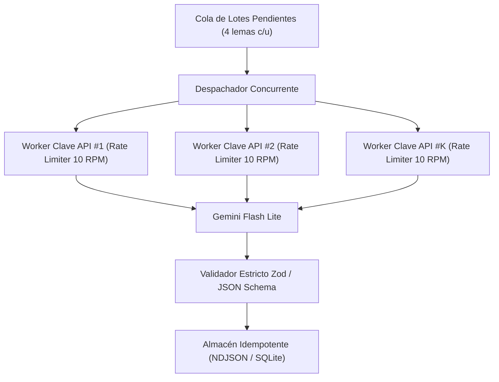

# Requisitos Funcionales: Motor de Ingesta y Generación de Vocabulario Asistido por IA

## 1. Propósito y Alcance del Módulo

Definir los requisitos técnicos, arquitectónicos y operativos del motor de ingesta masiva y resiliencia encargado de generar el contenido léxico enriquecido (definición pedagógica, traducción contextual, fonética IPA, morfología verbal completa y oraciones de ejemplo auténticas) a partir de un listado plano de lemas (*seed lemmas*).

El sistema utiliza la API de Google Gemini (modelo `gemini-3.5-flash-lite`) mediante un pipeline robusto por lotes (*batch pipeline*), diseñado para operar con múltiples claves API concurrentes, control estricto de cuotas (RPM/RPD), tolerancia a fallos de red/servidor (HTTP 429, 503) y persistencia idempotente orientada a fallos sin pérdida de progreso.

---

## 2. Decisiones de Diseño y Estrategia del Pipeline

### 2.1 Tamaño de Lote Óptimo por Petición (*Batch Sizing*)

- **Decisión:** **4 lemas por petición a la IA** (optimizado para fichas pedagógicas profundas con polisemia, fonética detallada, verbos frasales y oraciones graduadas, garantizando ~40 palabras/min por worker a 10 RPM).
- **Justificación técnica:**
  1. *Límites de Salida y Truncamiento*: Una ficha léxica completa estructurada en JSON ocupa entre 300 y 450 tokens. Un lote de 4 palabras genera entre 1.200 y 1.800 tokens de respuesta estructurada, situándose holgadamente dentro del límite seguro de completitud del modelo sin riesgo de corte o JSON corrupto.
  2. *Atención y Fatiga Sintética*: En peticiones con pocos lemas, el modelo mantiene la más alta fidelidad y exhaustividad en las acepciones, fonética IPA y oraciones de ejemplo sin omitir campos.
  3. *Radio de Explosión de Fallos (Blast Radius)*: Si una petición falla tras consumir tiempo de cómputo, reintentar un lote de 4 palabras tiene un coste insignificante en latencia comparado con reintentar un lote grande.

### 2.2 Estrategia de Rotación de Múltiples Claves API (*API Key Pool*)

- **Decisión:** **Rotación Dinámica Distribuida (*Round-Robin Concurrente con Rate Limiter por Clave*)**.
- **Justificación técnica frente al agotamiento secuencial:**
  - Si se agotara la cuota RPD de una sola clave antes de pasar a la siguiente, se estrangularía la velocidad total al límite de 10 RPM de esa única clave (máximo 40 palabras/minuto), prolongando el tiempo de procesamiento total.
  - Al distribuir las peticiones entre un pool de $K$ claves mediante semáforos individuales:
    - Se aprovecha la concurrencia multiplicada: con 4 claves a 10 RPM cada una, el sistema procesa hasta 40 peticiones/minuto (160 palabras/minuto).
    - El reparto de carga evita que los proveedores apliquen estrangulamientos transitorios de IP o límites de ráfaga (*burst limits*).
  - **Manejo de Agotamiento Diario (RPD = 500)**: Cuando una clave alcanza su límite diario (HTTP 429 por cuota diaria agotada), el pool la marca como `EXHAUSTED_UNTIL_MIDNIGHT_UTC` y continúa operando de forma transparente con las claves restantes.

---

## 3. Requisitos Funcionales del Motor de Ingesta

### RF-GEN-01: Ingesta de Listado Semilla y Normalización

- El motor debe aceptar como entrada un listado plano de lemas (`seed_words.json` o similar) que contenga la palabra base y metadatos de origen opcionales (ej. banda de frecuencia o ranking).
- El motor debe normalizar cada lema: conversión a minúsculas, eliminación de espacios en blanco y deduplicación estricta antes de ingresar a la cola de procesamiento.

### RF-GEN-02: Segmentación y Despacho en Lotes (*Batching*)

- El pipeline debe fragmentar la lista total en fragmentos uniformes de tamaño configurable $N$ (por defecto $N = 4$ lemas por lote).
- Cada lote debe poseer un identificador determinista único (`batch_id: b_0001`, `b_0002`, etc.) calculado en función del rango de índices de los lemas que contiene.

### RF-GEN-03: Pool Concurrente de Claves API y Rate Limiting Multi-Token

- El sistema debe gestionar un conjunto dinámico de $K$ claves API configurables mediante variables de entorno (`GEMINI_API_KEYS="key1,key2,key3"`).
- **Control de Tasa por Clave (Leaky Bucket / Token Bucket Local)**:
  - Cada clave debe disponer de su propio limitador de velocidad en memoria:
    - Máximo 10 peticiones por minuto (1 petición cada 6.000 ms por clave/worker para respetar la tasa de 10 RPM).
    - Concurrencia máxima por clave: 1 petición simultánea activa (*in-flight*).
- **Despachador Concurrente Global**:
  - La cola global de lotes despacha tareas a cualquier clave disponible que cumpla con su ventana de tiempo del limitador.


    Key1 --> AI["Gemini Flash Lite"]
    Key2 --> AI
    KeyN --> AI
    AI --> Validator["Validador Estricto Zod / JSON Schema"]
    Validator --> Storage["Almacén Idempotente (NDJSON / SQLite)"]
```

### RF-GEN-04: Contrato Estricto de Salida con la IA (*Structured Output*)

- El motor debe exigir a Gemini una salida estructurada formal mediante `responseMimeType: "application/json"` y un esquema JSON estricto (`responseSchema`).
- El esquema debe validar y tipar todos los requisitos establecidos en [`01_vocab_bank.md`](file:///c:/Users/Josnaiker%20Rivas/Desktop/english_learning_assistant/docs/02_functional_specs/01_vocab_bank.md):
  - `word`: Lema normalizado.
  - `grammatical_dimension`: `'CONTENT'` | `'FUNCTION'` | `'CHUNK'`.
  - `part_of_speech`: Categoría gramatical principal.
  - `cefr_level`: Nivel asignado pedagógicamente (`'A1'` a `'C1'`).
  - `definition_en`: Redactada en inglés simple (*Learner English*).
  - `translation_es`: Traducción natural y precisa al español.
  - `ipa_general_american` e `ipa_received_pronunciation`: Transcripciones fonéticas AFI válidas.
  - `verb_tenses`: Para verbos (regulares e irregulares): infinitivo, 3ra persona singular, pasado simple, participio pasado, gerundio y flag de irregularidad.
  - `phonetic_ed_ending`: Para verbos regulares (`'/t/'` | `'/d/'` | `'/ɪd/'`).
  - `is_false_friend`: Booleano y nota explicativa con el término alternativo en caso positivo.
  - `graduated_examples`:
    - Ejemplo 1 básico (A2-B1): Oración auténtica, traducción al español y `cloze_target`.
    - Ejemplo 2 avanzado (B2-C1): Oración auténtica avanzada, traducción y `cloze_target`.
- Si la respuesta de la IA no supera la validación sintáctica del esquema (ej. campos nulos o formato incorrecto), el lote es rechazado y enviado a la cola de reintento.

### RF-GEN-05: Mecanismo de Resiliencia, Backoff Exponencial y Política de Reintentos

- **Manejo de Errores HTTP 429 (Rate Limit / Quota Exceeded)**:
  - *Por RPM (peticiones por minuto)*: Se aplica espera con backoff exponencial y jitter aleatorio: 
    $$
T_{\text{wait}} = 2^{\text{intento}} \times 1000\,\text{ms} + \text{random}(200, 800)\,\text{ms}
$$
  - *Por RPD (cuota diaria agotada)*: La clave se suspende temporalmente en el pool y el lote se reasigna inmediatamente a otra clave activa.
- **Manejo de Errores HTTP 503 / 500 / Overloaded**:
  - Reintento automático con backoff de 3 a 5 segundos (hasta un máximo de 5 reintentos por lote).
- **Manejo de Timeout de Red y JSON Incompleto**:
  - Timeout de petición configurado en 30 segundos.
  - En caso de aborto o timeout, el lote vuelve a la cabecera de la cola sin penalizar el progreso general.
- **Dead Letter Queue (DLQ)**:
  - Si un lote falla consecutivamente tras 5 intentos en distintas claves, se registra en un archivo `failed_batches.json` con el detalle del error y el pipeline continúa con los lotes restantes sin detener la ejecución global.

### RF-GEN-06: Formato de Almacenamiento, Persistencia e Idempotencia

- **Decisión de Almacenamiento Intermedio**: **NDJSON (Newline Delimited JSON)** / Registros Atómicos en Disco (`generated_batches/batch_XXXXX.json`).
- **Justificación técnica**:
  - *Cero corrupción por interrupciones*: A diferencia de un archivo JSON gigante de 5.000 objetos donde una interrupción a mitad de escritura rompe el árbol sintáctico, los archivos por lote o NDJSON se escriben en modo atómico (*append-only* o archivo cerrado por lote).
  - *Idempotencia y Reanudación Instantánea (Resume Capability)*:
    - Antes de despachar un lote, el motor comprueba si los lemas del lote ya existen en el almacenamiento de resultados.
    - Si el script se cancela (ej. `Ctrl+C`, corte de energía o caída del servidor), al relanzarlo se lee el directorio de lotes generados y se reanuda exactamente desde el primer lote pendiente sin duplicar llamadas a la API ni desperdiciar tokens.
- **Compilación Final**:
  - Un proceso de compilación une todos los lotes validados, genera los identificadores definitivos (`voc_core_00001` a `voc_core_05000`) e inyecta los datos directamente en `core-vocab-corpus.json` y en la base de datos SQLite del sistema (`vocab_items`, `phraseological_units`, `vocab_context_examples`).

### RF-GEN-07: Métricas, Telemetría y Barra de Progreso en Tiempo Real

- El proceso CLI debe emitir un panel de estado en tiempo real que reporte:
  - Progreso total: Lemas generados / Total (`[████████░░] 3.500 / 5.000 - 70%`).
  - Estado del Pool de Claves: Claves activas, peticiones por minuto actuales por clave y cuota restante estimada.
  - Latencia promedio por lote (segundos).
  - Contador de reintentos y errores amortiguados (429s, 503s).
  - Tiempo estimado para finalización (*ETA*).