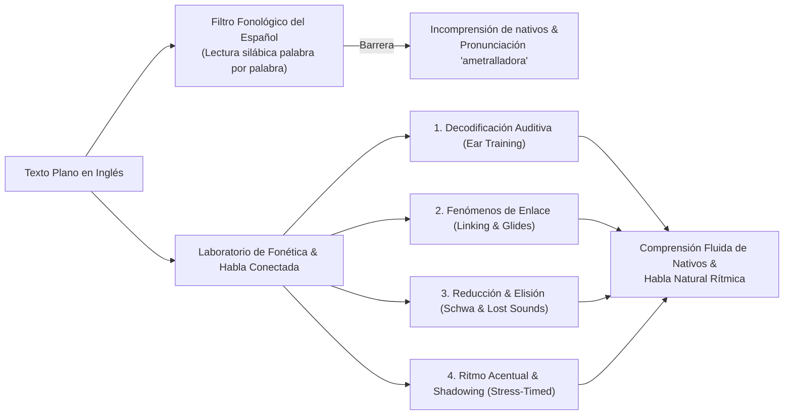

# Requisitos Funcionales: Laboratorio de Fonética y Habla Conectada (Connected Speech & Pronunciation Lab)

## 1. Propósito y Fundamentación Pedagógica del Módulo

Proporcionar un entorno de entrenamiento especializado y científicamente fundamentado para **desbloquear la comprensión auditiva del inglés nativo rápido (*fast speech decoding*)** y desarrollar una **producción oral fluida, rítmica y natural (*connected speech production*)**, libre de las distorsiones causadas por la interferencia de la lengua materna (L1 español).

### 1.1 El Problema Lingüístico Central del Hispanohablante
1. **Ritmo Silábico vs. Ritmo Acentual**:
   * El español es un idioma de **ritmo silábico (*syllable-timed*)**: cada sílaba tiene aproximadamente la misma duración musical.
   * El inglés es un idioma de **ritmo acentual (*stress-timed*)**: el intervalo de tiempo entre sílabas acentuadas es constante. Para lograr esto, el inglés **comprime, elide o reduce a Schwa (/ə/)** todas las palabras y sílabas átonas intermedias.
2. **La Ilusión de la Palabra Aislada**:
   * Los nativos no hablan con pausas entre palabras. En el habla conectada, las consonantes finales migran a la siguiente palabra, las vocales se fusionan mediante semivocales y consonantes como `/t/` y `/d/` desaparecen.
   * Cuando el estudiante busca en el audio palabras individuales con sus sonidos de diccionario, su cerebro se satura y se produce la sensación de que *"los nativos hablan demasiado rápido y se comen las letras"*.

---

## 2. Catálogo de Fenómenos Fonéticos Suprasegmentales

El módulo cataloga, visualiza y entrena sistemáticamente los 6 fenómenos fundamentales del habla conectada:

### RF-PHON-01: Enlaces Consonante-Vocal (*Catenation / Consonant-to-Vowel Linking*)
* Cuando una palabra termina en sonido consonántico y la siguiente comienza con sonido vocálico, la consonante se transfiere naturalmente al inicio de la siguiente sílaba (*resyllabification*):
  * *tur**n o**ff* $\rightarrow$ `/tɜː.nɒf/` (el usuario escucha *"tur-noff"*).
  * *hol**d o**n* $\rightarrow$ `/hoʊl.dɑːn/` (el usuario escucha *"hol-don"*).
  * *bac**k u**p* $\rightarrow$ `/bæ.kʌp/`.

### RF-PHON-02: Enlaces Vocal-Vocal e Intrusión de Semivocales (*Glides /j/, /w/ e Intrusive /r/*)
* Para evitar pausas glotales artificiales (*hiatus*), el inglés inserta semivocales de transición suaves entre dos sonidos vocálicos contiguos:
  * **Intrusión de `/j/`**: Ocurre tras vocales anteriores o diptongos que terminan con lengua elevada (/iː/, /eɪ/, /aɪ/, /ɔɪ/):
    * *see it* $\rightarrow$ `/siː‿j‿ɪt/` (*"see-yit"*).
    * *I agree* $\rightarrow$ `/aɪ‿j‿əˈɡriː/` (*"I-yagree"*).
    * *they are* $\rightarrow$ `/ðeɪ‿j‿ɑːr/`.
  * **Intrusión de `/w/`**: Ocurre tras vocales posteriores o diptongos con labios redondeados (/uː/, /oʊ/, /aʊ/):
    * *go out* $\rightarrow$ `/ɡoʊ‿w‿aʊt/` (*"go-wout"*).
    * *you are* $\rightarrow$ `/juː‿w‿ɑːr/` (*"you-war"*).
    * *too often* $\rightarrow$ `/tuː‿w‿ˈɒf.ən/`.
  * **Intrusive R** (en acentos no róticos como British RP):
    * *law and order* $\rightarrow$ `/lɔː‿r‿ənd ˈɔː.dər/`.

### RF-PHON-03: Elisión Consonántica (*Lost Sounds / Consonant Deletion*)
* Supresión de sonidos que no se pronuncian para acelerar la articulación motora en grupos consonánticos densos:
  * **Elisión de `/t/` y `/d/`**: Cuando `/t/` o `/d/` se encuentran entre dos consonantes, se omiten por completo:
    * *nex(t) door* $\rightarrow$ `/nɛks dɔːr/` (no se pronuncia la `t`).
    * *firs(t) time* $\rightarrow$ `/fɜːs taɪm/`.
    * *hol(d) tight* $\rightarrow$ `/hoʊl taɪt/`.
    * *you an(d) me* $\rightarrow$ `/juː ən miː/`.
  * **Elisión de Schwa en sílabas internas átonas**:
    * *fam(i)ly* $\rightarrow$ /ˈfæm.li/ (2 sílabas, no 3).
    * *cam(e)ra* $\rightarrow$ /ˈkæm.rə/.
    * *rest(au)rant* $\rightarrow$ /ˈrɛs.trɑːnt/.

### RF-PHON-04: Asimilación Fonética (*Assimilation*)
* Un sonido cambia de cualidad para adaptarse al punto de articulación del sonido adyacente:
  * **Asimilación Coalescente con `/j/`**:
    * `/t/ + /j/ \rightarrow /tʃ/`: *don't you* $\rightarrow$ `/doʊn.tʃuː/` (*"don-choo"*), *meet you* $\rightarrow$ /ˈmiː.tʃuː/.
    * `/d/ + /j/ \rightarrow /dʒ/`: *did you* $\rightarrow$ /ˈdɪ.dʒuː/ (*"did-joo"*), *would you* $\rightarrow$ /ˈwʊ.dʒuː/.
  * **Asimilación Regresiva de Lugar**:
    * *ten boys* $\rightarrow$ `/tɛm bɔɪz/` (la /n/ alveolar se bilabializa en /m/ anticipando la /b/).
    * *good boy* $\rightarrow$ `/ɡʊb bɔɪ/`.

### RF-PHON-05: Formas Débiles y Reducción a Schwa (*Weak Forms in Discourse*)
* Las palabras gramaticales o funcionales (preposiciones, conjunciones, pronombres, verbos auxiliares) en posición átona reducen sistemáticamente su vocal completa al sonido neutro Schwa (/ə/) o eliminan vocales:
  * *can*: aislado `/kæn/` $\rightarrow$ en oración `/kən/` (*I can do it* $\rightarrow$ `/aɪ kən ˈduː ɪt/`).
  * *to*: aislado `/tuː/` $\rightarrow$ en oración `/tə/` (*go to work* $\rightarrow$ `/ɡoʊ tə ˈwɜːrk/`).
  * *for*: aislado `/fɔːr/` $\rightarrow$ en oración `/fər/` (*waiting for you* $\rightarrow$ `/ˈweɪ.tɪŋ fər juː/`).
  * *of*: aislado `/ɒv/` $\rightarrow$ en oración `/əv/` o `/ə/` (*piece of cake* $\rightarrow$ `/piːs ə keɪk/`).
  * *and*: aislado `/ænd/` $\rightarrow$ en oración `/ən/` o `/n/` (*rock and roll* $\rightarrow$ `/rɑːk n roʊl/`).

### RF-PHON-06: Fonología Alomórfica del Inglés Americano (*Flap T y Glottal Stop*)
* **Flap T / Tap T (/ɾ/)**:
  * En inglés americano, cuando `/t/` o `/d/` se ubican entre dos vocales (o tras una `r` vocalizada) y la segunda sílaba es átona, se transforman en una vibrante alveolar simple suave /ɾ/ (idéntica a la "r" simple del español en *pero*):
    * *water* $\rightarrow$ /ˈwɑː.ɾər/ (no /ˈwɔː.tər/).
    * *better* $\rightarrow$ /ˈbɛ.ɾər/.
    * *get out* $\rightarrow$ /ɡɛ.ˈɾaʊt/.
    * *party* $\rightarrow$ /ˈpɑːr.ɾi/.
* **Glottal Stop (/ʔ/)**:
  * Oclusión de las cuerdas vocales cuando `/t/` precede a una consonante silábica nasal `/n/`:
    * *button* $\rightarrow$ /ˈbʌʔ.n̩/.
    * *fitness* $\rightarrow$ /ˈfɪʔ.nəs/.

---

## 3. Modalidades de Práctica y Componentes de Interfaz

El laboratorio se organiza en 4 áreas funcionales complementarias:

### RF-PHON-07: Gimnasio de Decodificación Auditiva de Habla Rápida (*Fast Speech Gym*)
* **Mecánica**: El sistema reproduce un clip breve a velocidad nativa natural (1.0x o 1.1x) usando Kokoro TTS con fenómenos de elisión y enlace.
* **Tipología de Retos**:
  1. *Discriminación Múltiple con Distractores de L1*:
     * El usuario debe identificar cuál fue la frase emitida entre distractores basados en trampas acústicas del español.
  2. *Audio Cloze de Palabras Reducidas*:
     * La interfaz muestra la oración con espacios en blanco correspondientes **únicamente a las palabras funcionales reducidas** (*have, to, for, could've, been*). El usuario debe rellenarlas basándose en la prosodia.
  3. *Toggle de Revelación Acústica*:
     * Permite alternar instantáneamente entre la versión reducida nativa (1.0x) y la versión articulada lenta (0.75x) para comparar auditivamente la transformación.

### RF-PHON-08: Visualizador Fonotáctico Enriquecido (*Connected Speech Visualizer*)
* Presentación visual intuitiva de las oraciones que hace visibles los fenómenos acústicos invisibles:
  * **Ligaduras Curvas (*Slurs*)**: Arcos visuales entre palabras enlazadas (*linking*), coloreados en índigo:
    $$\text{turn}\smile\text{off}$$
  * **Insignias de Semivocales Intrusivas**: Pequeños indicadores superiores `[j]` o `[w]` en tono violeta entre vocales contiguas:
    $$\text{see}\overset{\text{[j]}}{\smile}\text{it}$$
  * **Caracteres Atenuados / Tachados**: Las consonantes elididas aparecen en color atenuado con tachado suave (*strike-through*):
    $$\text{nex}\cancel{\text{t}}\text{ door}$$
  * **Destacado Rítmico (Stress Highlighting)**:
    * Las palabras de contenido con significado pleno (*Content Words*: sustantivos, verbos principales, adjetivos) se presentan con tipografía contrastada y de mayor peso visual.
    * Las palabras funcionales (*Structure Words*: artículos, preposiciones, pronombres) aparecen con menor intensidad, reflejando su compresión temporal.

### RF-PHON-09: Taller de Shadowing y Ritmo Acentual (*Stress-Timed Shadowing Studio*)
* Metodología de entrenamiento neuromuscular en 4 fases secuenciales por oración:
  1. **Fase 1: Escucha Consciente (Silent Listening)**: Reproducción a 1.0x sin hablar, observando la distribución rítmica.
  2. **Fase 2: Noticing & Metrónomo Rítmico**: Señal visual con pulsos de tiempo (*beats*) que marcan exclusivamente los golpes de acento prosódico.
  3. **Fase 3: Shadowing Asistido Lento (0.75x)**: El usuario reproduce la frase al unísono con el modelo de Kokoro TTS a velocidad reducida.
  4. **Fase 4: Shadowing Nativo al Unísono (1.0x)**: Reproducción continua al ritmo nativo.
  * Opcionalmente, permite la grabación local temporal con el micrófono (vía Web Audio API en el navegador) para reproducir en paralelo su voz frente a la pista de Kokoro TTS (*Self-Correction Loop* privado, sin persistencia en la nube).

### RF-PHON-10: Gimnasio de Pares Mínimos Críticos para Hispanohablantes (*Minimal Pairs*)
* Módulo correctivo enfocado en los contrastes fonológicos donde el español carece de distinción y fusiona los sonidos:
  * **Vocal Tensas vs. Laxas**: `/iː/` vs `/ɪ/` (*sheep* vs *ship*, *leave* vs *live*); `/uː/` vs `/ʊ/` (*pool* vs *pull*).
  * **Consonantes Problemáticas de la L1**:
    * `/b/` vs `/v/` (*berry* vs *very*, *boat* vs *vote*).
    * `/s/` vs `/z/` (*price* vs *prize*, *sue* vs *zoo*).
    * `/ʃ/` vs `/tʃ/` (*share* vs *chair*, *wash* vs *watch*).
  * **Evitación de la /e/ Protética Inicial**:
    * Práctica de clusters con `/s/` inicial sin anteponer una *"e"* (*stop*, no *\*estop*; *special*, no *\*especial*).

---

## 4. Integración con el Motor Central SRS

* **RF-PHON-11: Mazo Especializado de Fonética y Discriminación Auditiva**:
  * Las habilidades fonéticas no deben evaluarse en el mazo léxico, sino en su propia cola de repetición espaciada:
    * **Perfil SRS**: `PHONETIC_ACUITY` (con retención objetivo $r_{\text{target}} = 0.90$).
    * **Objetivo de la Tarjeta**: Estímulo 100% auditivo (el audio se reproduce inmediatamente sin texto visible). El usuario debe discernir el contenido en 5 a 8 segundos antes de voltear la tarjeta para ver la transcripción con ligaduras fonotácticas.
    * **Target Type**: `target_type = 'PHONETIC_DRILL'`.

---

## 5. Conexión Bidireccional con Vocabulario y Redacción

* **RF-PHON-12: Enrutamiento Contextual Inter-Módulos**:
  * **Desde la Ficha de Vocabulario**: El drawer de detalle de cada palabra incluye un botón: *"🎧 Practicar habla conectada y ritmo de este término en contexto"*, que abre el Laboratorio de Fonética cargando directamente las oraciones graduadas de dicha palabra.
  * **Hacia el Taller de Redacción**: Durante la evaluación formativa de textos, cuando la IA detecte errores recurrentes de preposiciones o palabras funcionales fosilizadas, sugerirá al usuario realizar una sesión de *Fast Speech Decoding* de esas mismas estructuras en el Laboratorio de Fonética.
