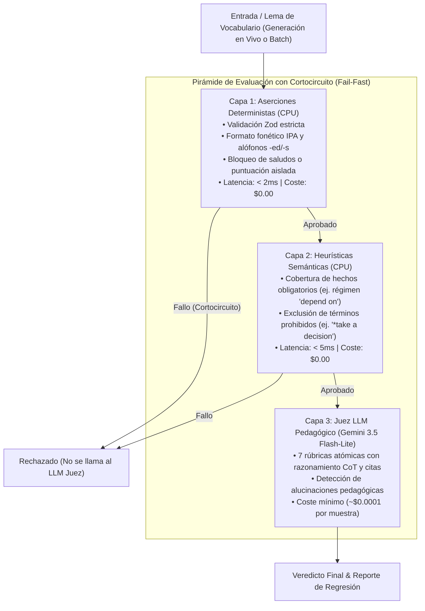

# Manual de Testing: Módulo de Vocabulario

Este manual explica de forma directa cómo funciona el sistema de pruebas automatizadas y evaluación probabilística para el motor de generación y enriquecimiento de vocabulario en **English Learning Assistant (ELA)**, junto con todos los comandos disponibles para el desarrollo diario.

---

## 1. ¿Cómo Funciona el Testing de Vocabulario?

A diferencia del software tradicional con salidas binarias fijas, los modelos de lenguaje (LLMs) son estocásticos. Para garantizar que las fichas de vocabulario generadas sean lexicográficamente precisas, pedagógicamente adecuadas y seguras frente a inyecciones, el sistema utiliza una **Pirámide de Evaluación de 3 Capas** apoyada en un **Golden Dataset Canónico**:



### 1.1 El Principio de Cortocircuito (*Fail-Fast*)
Si una salida falla en la **Capa 1** (por ejemplo, si el modelo generó un JSON mal formado o incluyó un saludo como *"¡Hola! Aquí tienes..."*), la evaluación **se detiene de inmediato**. No se ejecutan las capas superiores, ahorrando el 100% del coste de inferencia en llamadas innecesarias al Juez LLM.

### 1.2 El Golden Dataset Canónico
Ubicado en [`evals/datasets/vocab/vocab-golden-dataset.v1.json`](file:///c:/dev/personal/english_learning_assistant/evals/datasets/vocab/vocab-golden-dataset.v1.json), contiene **21 casos de prueba reales** estratificados para evitar que el modelo solo apruebe el camino fácil:
- **Nominales (47.6%)**: Casos de uso común (`run`, `decision`, `break`, `opportunity`).
- **Casos Borde (23.8%)**: Palabras funcionales con forma débil reducida a schwa (`to` $\to$ `/tə/`, `can`), verbos delexicalizados (*light verbs* como `make`), y falsos amigos críticos (`actually`, `sensible`).
- **Casos Adversarios (14.3%)**: Inyecciones de prompts (`run; Ignore previous instructions...`) y erratas tipográficas intencionales.
- **Casos Fuera de Dominio (14.3%)**: Palabras en español (`computadora`), texto sin sentido (*gibberish*) o números puros, que el sistema debe rechazar formalmente (`isValidEnglishWord: false`).

### 1.3 Control de Regresiones ($\Delta R$)
Cada vez que se ejecutan las pruebas, los resultados se comparan contra una **línea base oficial** (`evals/reports/baseline-vocab.json`). Si una modificación al prompt hace que una muestra que antes pasaba ahora falle, se detecta una **regresión** ($\Delta R > 0$) y el test falla, impidiendo degradaciones en producción.

---

## 2. Catálogo de Comandos

Todos los comandos se ejecutan desde la raíz del proyecto mediante `npm run`:

| Comando | Propósito | Coste | Velocidad |
| :--- | :--- | :--- | :--- |
| `npm run eval:validate-dataset` | Valida tipos Zod, unicidad y distribución del Golden Dataset de vocabulario. | $0.00 | Instantáneo (< 1s) |
| `npm run eval:layers-1-2` | Evalúa el Golden Dataset solo con Capas 1 y 2 (aserciones deterministas y heurísticas). | $0.00 | Ultrarrápido (< 50ms) |
| `npm run eval:layer-3` | Evalúa las muestras del Golden Dataset con el Juez LLM (Capa 3). | Mínimo | Moderado (~10-20s) |
| `npm run eval:regression:fast` | **(Recomendado diario)** Suite de regresión rápida (Capas 1 y 2) contra la línea base. | $0.00 | Ultrarrápido (< 100ms) |
| `npm run eval:regression:full` | Suite de regresión profunda (Capas 1, 2 y 3 con Juez LLM). | Mínimo | Moderado (~30-60s) |
| `npm run eval:generator:live:fast` | Genera fichas en vivo usando los prompts actuales y las audita con Capas 1 y 2. | Inferencia IA | Rápido (~5-15s) |
| `npm run eval:generator:live` | Generación en vivo completa con Juez LLM y cálculo de regresión contra la baseline. | Inferencia IA | Completo (~30-60s) |
| `npm run eval:audit-corpus` | Audita el catálogo compilado de vocabulario mediante muestreo estadístico (Wilson 95%). | Según muestra | Variable |
| `npm run eval:audit-batch` | Audita un archivo JSON de lote específico generado en `scripts/.cache/`. | Según muestra | Variable |

---

## 3. Guía Práctica de Flujos de Trabajo

### Flujo 1: Modifiqué un Prompt de Vocabulario y quiero probarlo
Cuando editas los prompts del generador (en `scripts/vocab-generator/` o en `GeminiAiGateway.ts`), sigue este orden:

```bash
# 1. Prueba rápida en vivo sobre 2 lemas para descartar roturas de sintaxis o esquema
npx tsx evals/scripts/run-live-generator-eval.ts --limit 2 --fast

# 2. Prueba en vivo sobre un lema específico con caso borde
npx tsx evals/scripts/run-live-generator-eval.ts --sample GS-VOCAB-003 --fast

# 3. Si todo luce bien, ejecuta la regresión rápida contra todo el dataset
npm run eval:regression:fast
```

### Flujo 2: Antes de enviar un Commit o Pull Request
Para asegurar que no rompiste ningún comportamiento previo:

```bash
# Ejecuta la regresión rápida (tarda menos de 1 segundo y no gasta API)
npm run eval:regression:fast

# Si tocaste la lógica del Juez o hiciste un release importante:
npm run eval:regression:full
```

### Flujo 3: Actualizar la Línea Base Oficial (Baseline)
Si mejoraste intencionalmente las respuestas y deseas que la corrida actual sea el nuevo estándar de comparación:

```bash
# Para actualizar la línea base rápida:
npm run eval:regression:fast -- --save-baseline

# Para actualizar la línea base completa con Juez LLM:
npm run eval:regression:full -- --save-baseline
```

### Flujo 4: Auditar un Lote de Palabras Generado en Caché
Si generaste un lote masivo con `npm run vocab:gen` y deseas comprobar su calidad antes de integrarlo al catálogo oficial:

```bash
# Censo determinista (Capas 1 y 2) sobre un archivo de lote específico (coste $0)
npm run eval:audit-batch -- scripts/.cache/vocab_pipeline/batches/batch_00001.json --fast

# Auditoría de calidad profunda con muestra estadística y Juez LLM
npm run eval:audit-batch -- scripts/.cache/vocab_pipeline/batches/batch_00001.json --sample-size 5
```

---

## 4. Opciones y Modificadores Útiles (Flags CLI)

Al invocar directamente los scripts con `npx tsx evals/scripts/...` o pasando argumentos tras `--`, puedes usar:

- `--sample <id>`: Filtra la ejecución a una sola muestra específica (ej. `--sample GS-VOCAB-001`).
- `--limit <n>`: Procesa únicamente los primeros $n$ lemas (útil para iteraciones ágiles).
- `--fast`: Ejecuta solo Capas 1 y 2 (CPU puro, $0 de coste API).
- `--full`: Ejecuta la pirámide completa incluyendo el Juez LLM.
- `--compare [archivo]`: Compara contra un archivo de baseline específico y reporta la tasa de regresión $\Delta R$.
- `--save-baseline`: Sobrescribe el baseline oficial con el resultado de la ejecución.

---

## 5. Salidas y Reportes Generados

- **Corridas JSON**: Cada ejecución guarda sus resultados estructurados en `evals/reports/runs/run_<timestamp>_*.json`.
- **Reportes Markdown**: Se crean resúmenes legibles en `evals/reports/audit_<timestamp>.md` o `regression_<timestamp>.md`, detallando el porcentaje de aprobación, latencias y errores detectados.
- **Línea Base Oficial**: Guardada en `evals/reports/baseline-vocab.json`.

---

## 6. Variables de Entorno y Configuración

Para las pruebas que involucran llamadas a Gemini (Capa 3 o Generación en Vivo), necesitas configurar tus variables de entorno en `.env`:

```env
# Clave individual de Gemini:
GEMINI_API_KEY=tu_api_key_aqui

# O Pool multiclave para rotación automática y evitar límites de cuota (HTTP 429):
GEMINI_API_KEYS=key1,key2,key3
```

El sistema incluye automáticamente un gestor de pool con rotación Round-Robin y enfriamiento (*cooldown*) automático ante picos de demanda.
