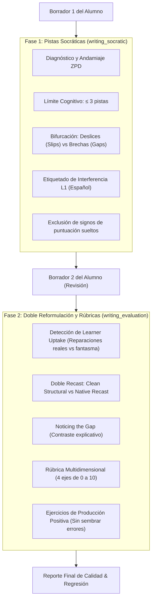

# Manual de Testing: Módulo del Taller de Redacción

Este manual explica de forma directa cómo funciona el sistema de pruebas automatizadas y evaluación probabilística para el **Taller de Redacción (Writing Workshop)** en **English Learning Assistant (ELA)**, cubriendo sus dos fases pedagógicas y el catálogo completo de comandos para el día a día.

---

## 1. ¿Cómo Funciona el Testing del Taller de Redacción?

El Taller de Redacción no busca simplemente corregir errores gramaticales como un corrector ortográfico convencional. Su objetivo es pedagógico: guiar al estudiante mediante el método socrático para que descubra sus propios errores y desarrolle competencia en inglés con foco en la **interferencia del español (L1)**.

Por esta razón, el sistema de testing evalúa dos fases pedagógicas claramente diferenciadas:



### 1.1 Las Dos Fases Pedagógicas Evaluadas

1. **Fase 1: Pistas Socráticas y Andamiaje ZPD (`writing_socratic`)**:
   - **Cota Cognitiva**: Máximo 3 pistas simultáneas para no abrumar al estudiante.
   - **Clasificación del Error**: Diferenciación precisa entre *Slip* (desliz que el alumno puede corregir solo) y *Gap* (brecha conceptual que requiere explicación).
   - **Sin Falsos Positivos de Puntuación**: No marca signos como `,` o `.` aislados como si fueran palabras erróneas.
   - **Interferencia L1**: Identifica calcos comunes de hispanohablantes (ej. `*depend of`, `*make a party`, omisión de sujeto).

2. **Fase 2: Doble Reformulación y Rúbricas (`writing_evaluation`)**:
   - ***Learner Uptake***: Evalúa si el alumno aplicó las pistas del Borrador 1 al Borrador 2, evitando "reparaciones fantasma".
   - **Doble Reformulación (*Recast*)**:
     - *Clean Structural*: Corrige solo errores gramaticales manteniendo la estructura y voz original del alumno.
     - *Native Recast*: Reescribe de forma fluida y natural cómo lo expresaría un hablante nativo.
   - ***Noticing the Gap***: Explicaciones directas y concisas sobre por qué la versión nativa suena más natural.
   - **Rúbrica Calibrada**: Calificación de 0 a 10 en cuatro dimensiones: Logro de la tarea (*Task Achievement*), Gramática y precisión (*Grammar & Accuracy*), Recurso léxico (*Lexical Resource*) y Coherencia (*Coherence & Cohesion*).

---

## 2. La Pirámide de Evaluación de 3 Capas

Al igual que en el módulo de vocabulario, las pruebas operan con un principio estricto de **cortocircuito (*fail-fast*)**:

- **Capa 1: Aserciones Deterministas (CPU, $0.00, < 2ms)**:
  - Valida esquemas Zod estrictos.
  - Verifica cotas: $\le 3$ pistas en Fase 1, notas entre 0 y 10 en Fase 2.
  - Comprueba que las reformulaciones contengan texto y que los identificadores de error sean válidos.
- **Capa 2: Heurísticas Semánticas (CPU, $0.00, < 5ms)**:
  - Analiza overlap léxico y cobertura de conceptos de interferencia L1.
  - Verifica tono socrático (presencia de preguntas estimulantes y ausencia de lenguaje punitivo).
- **Capa 3: Juez LLM Pedagógico (`WritingLlmJudge`)**:
  - Utiliza Gemini con rúbricas especializadas para juzgar la pertinencia didáctica de las pistas y la calidad del *recast*.

---

## 3. Los Golden Datasets de Redacción

Los datos de referencia dorada están separados por fase en `evals/datasets/writing/`:

1. [`writing-socratic-golden-dataset.v1.json`](file:///c:/dev/personal/english_learning_assistant/evals/datasets/writing/writing-socratic-golden-dataset.v1.json):
   - **18 muestras canónicas**: Casos nominales A2-B2 (tiempos verbales, concordancia distributiva 'every'), casos borde de transferencia sintáctica y léxica del español (`depend of`, *false friends* como *actually* y *sensible*, calco de edad `has 25 years`, do/make collocations, omisión de sujeto *pro-drop*, conectores subordinantes vs adverbios de transición, ortografía de hispanohablantes `enviroment/wich`, y control de saturación de carga cognitiva $\le 3$ pistas ante 5 errores), ataques adversarios de inyección de prompt e intentos de extracción de directivas del sistema, y entradas fuera de dominio (español puro y texto basura/símbolos).
2. [`writing-evaluation-golden-dataset.v1.json`](file:///c:/dev/personal/english_learning_assistant/evals/datasets/writing/writing-evaluation-golden-dataset.v1.json):
   - **14 muestras canónicas**: Pares Borrador 1 $\to$ Borrador 2 con auto-reparaciones completas (tiempos verbales, elevación léxica de registro), reparaciones parciales con errores persistentes (`am agree`, `attended to`, `people is`), integración de vocabulario meta SRS con detección de uso forzado (*unnatural collocation* en `elucidate`), hipercorrecciones y regresiones (`doesn't knows`), calcos dativos (`explain me`), inversiones retóricas estilísticas avanzadas (`Never before had I witnessed`), intentos adversarios de inyección mediante bloques de código markdown y borradores finales fuera de dominio en español.

> **Principio Anti-Autocomplacencia:** Más del **77%** de las muestras en ambos datasets corresponden a casos no-nominales (bordes, adversarios y fuera de dominio), superando holgadamente el mínimo exigido del 40%. Total: **32 muestras operativas**.

---

## 4. Catálogo de Comandos

Todos los comandos se ejecutan desde la raíz del proyecto mediante `npm run`:

| Comando                                | Propósito                                                                                 | Coste         | Velocidad             |
| :------------------------------------- | :---------------------------------------------------------------------------------------- | :------------ | :-------------------- |
| `npm run eval:writing:validate`        | Valida esquemas Zod, unicidad de IDs y sincroniza archivos `.jsonl`.                      | $0.00         | Instantáneo (< 1s)    |
| `npm run eval:writing:layers-1-2`      | Ejecuta Capas 1 y 2 (CPU) sobre los datasets de ambas fases.                              | $0.00         | Ultrarrápido (< 50ms) |
| `npm run eval:writing:layer-3`         | Audita las muestras canónicas con el Juez LLM (Capa 3).                                   | Mínimo        | Moderado (~15-30s)    |
| `npm run eval:writing:regression:fast` | **(Recomendado diario)** Suite de regresión rápida para ambas fases contra la línea base. | $0.00         | Ultrarrápido (< 50ms) |
| `npm run eval:writing:regression:full` | Suite de regresión completa (Capas 1, 2 y 3 con Juez LLM).                                | Mínimo        | Moderado (~30-60s)    |
| `npm run eval:writing:live:fast`       | Invoca a la IA en vivo para generar feedback y evalúa con Capas 1 y 2.                    | Inferencia IA | Rápido (~5-10s)       |
| `npm run eval:writing:live`            | Invoca a la IA en vivo para generar feedback completo con Juez LLM.                       | Inferencia IA | Completo (~20-40s)    |

---

## 5. Guía Práctica de Flujos de Trabajo

### Flujo 1: Modifiqué el Prompt del Tutor Socrático (Fase 1)
Si ajustaste la lógica de generación de pistas socráticas:

```bash
# 1. Prueba en vivo sobre las primeras 2 muestras de la Fase 1
npx tsx evals/scripts/run-writing-live-eval.ts --domain socratic --limit 2 --fast

# 2. Prueba en vivo sobre un caso específico de interferencia L1
npx tsx evals/scripts/run-writing-live-eval.ts --domain socratic --sample GS-WRT-SOC-003 --fast

# 3. Verifica que no haya regresiones contra el dataset canónico
npm run eval:writing:regression:fast -- --domain socratic
```

### Flujo 2: Modifiqué el Prompt de Reformulación o Rúbricas (Fase 2)
Si ajustaste los prompts de doble *recast* o calibración de notas:

```bash
# 1. Prueba en vivo sobre la Fase 2 (evaluación y recast)
npx tsx evals/scripts/run-writing-live-eval.ts --domain eval --limit 2 --fast

# 2. Ejecuta la regresión rápida de la Fase 2
npm run eval:writing:regression:fast -- --domain eval
```

### Flujo 3: Verificación Pre-Commit o Pull Request
Antes de confirmar cambios en el módulo de redacción:

```bash
# Valida la integridad de los datasets
npm run eval:writing:validate

# Ejecuta la suite de regresión rápida completa (ambas fases en menos de 50ms, coste $0)
npm run eval:writing:regression:fast
```

### Flujo 4: Actualizar la Línea Base Oficial (Baseline)
Cuando introduzcas mejoras intencionales y validadas en el comportamiento del tutor:

```bash
# Para actualizar la línea base rápida de ambas fases:
npm run eval:writing:regression:fast -- --save-baseline

# Para actualizar la línea base completa con Juez LLM:
npm run eval:writing:regression:full -- --save-baseline
```

---

## 6. Opciones y Modificadores Útiles (Flags CLI)

Al invocar los scripts con argumentos:

- `--domain socratic`: Procesa únicamente la Fase 1 (Pistas socráticas y andamiaje).
- `--domain eval`: Procesa únicamente la Fase 2 (Doble reformulación y rúbricas).
- `--sample <id>`: Filtra por una muestra específica (ej. `--sample GS-WRT-SOC-001` o `--sample GS-WRT-EVAL-002`).
- `--limit <n>`: Limita la cantidad de muestras procesadas (ej. `--limit 1` para un test ultra-ágil).
- `--fast`: Ejecuta solo Capas 1 y 2 ($0 coste API).
- `--full`: Ejecuta las 3 capas completas con Juez LLM.
- `--save-baseline`: Actualiza los archivos de línea base oficiales.
- `--compare [archivo]`: Compara los resultados contra una línea base existente.

---

## 7. Reportes y Líneas Base Generadas

- **Líneas Base Oficiales**:
  - `evals/reports/baseline-writing-socratic.json` (Línea base de Fase 1).
  - `evals/reports/baseline-writing-evaluation.json` (Línea base de Fase 2).
- **Reportes de Auditoría**: Cada corrida genera un reporte legible en Markdown en:
  - `evals/reports/audit_writing_socratic_<timestamp>.md`
  - `evals/reports/audit_writing_evaluation_<timestamp>.md`
- **Corridas Estructuradas**: Persistidas en `evals/reports/runs/run_writing_<timestamp>_*.json`.
