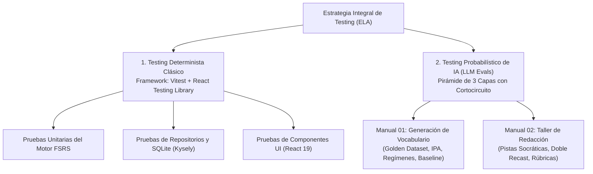

# Estrategia Global de Testing y Aseguramiento de Calidad (QA)

## 1. Visión Holística de Calidad: El Modelo Dual

**English Learning Assistant (ELA)** opera bajo dos paradigmas de ingeniería de software complementarios:

1. **Motores Deterministas Clásicos:** Lógica de espaciamiento por repetición espaciada (FSRS), persistencia y consultas relacionales en SQLite (Kysely), manipulación de audio en Rust/Tauri y componentes reactivos de UI.
2. **Capacidades Probabilísticas de IA:** Generación y enriquecimiento de fichas de vocabulario y retroalimentación socrática en el taller de redacción mediante Google Gemini.



---

## 2. Testing Determinista Clásico (Vitest)

Las pruebas unitarias y de integración de código tradicional verifican la estabilidad de la lógica determinista:

| Dominio | Herramienta | Alcance de Prueba | Comando de Ejecución |
| :--- | :--- | :--- | :--- |
| **Motor SRS (FSRS)** | Vitest | Intervalos de repetición espaciada, retención, estabilidad y dificultad. | `npm run test` |
| **Persistencia SQLite** | Vitest / sql.js | Migraciones de base de datos, repositorios Kysely e integridad referencial. | `npm run test` |
| **Pasarelas de IA (Gateways)** | Vitest | Mocks de red, serialización de contratos Zod y resiliencia de llamadas. | `npm run test` |
| **Componentes de UI** | React Testing Library | Renderizado accesible, formularios y navegación. | `npm run test` |

Comandos frecuentes:
```bash
npm run test           # Ejecuta todas las pruebas unitarias
npm run test:watch     # Modo observador interactivo
npm run test:coverage  # Genera reporte de cobertura de código
```

---

## 3. Testing Probabilístico de IA (LLM Evals)

Para auditar las salidas generadas por los modelos de lenguaje sin incurrir en costes masivos ni aceptar alucinaciones pedagógicas, el sistema implementa una **Pirámide de Evaluación con Cortocircuito (*Fail-Fast*)**:

1. **Capa 1: Aserciones Deterministas (CPU, $0.00, < 2ms):** Validación de esquemas Zod, cotas numéricas, formato fonético y prohibición de saludos o tokens de puntuación sueltos. Si falla, el test se detiene de inmediato.
2. **Capa 2: Heurísticas Semánticas (CPU, $0.00, < 5ms):** Cobertura de hechos obligatorios, detección de términos prohibidos y análisis de tono pedagógico.
3. **Capa 3: Juez LLM Pedagógico (Gemini 3.5 Flash-Lite):** Evaluación cualitativa profunda mediante rúbricas atómicas con justificación Chain-of-Thought (CoT).

### Manuales Operativos Detallados

La documentación operativa y el catálogo de comandos de testing de IA se encuentran organizados en dos manuales dedicados:

- 📖 **[Manual de Testing: Generación de Vocabulario](./01_manual_testing_vocabulario.md):**
  Explica la evaluación del motor de vocabulario, el Golden Dataset de 21 muestras estratificadas, las aserciones fonéticas/sintácticas, suites de regresión rápida/completa y comandos de auditoría estadística de lotes y corpus.

- 📖 **[Manual de Testing: Taller de Redacción Socrática](./02_manual_testing_taller_redaccion.md):**
  Explica la evaluación de las dos fases del taller (Fase 1: Pistas socráticas y andamiaje ZPD; Fase 2: Doble *recast* y rúbricas multidimensionales), detección de *Learner Uptake*, datasets de redacción y comandos de ejecución y regresión.

---

## 4. Matriz Rápida de Comandos

```bash
# =========================================================================
# 1. PRUEBAS DETERMINISTAS (VITEST)
# =========================================================================
npm run test                          # Ejecuta pruebas unitarias de TypeScript/React

# =========================================================================
# 2. EVALS DE VOCABULARIO
# =========================================================================
npm run eval:validate-dataset         # Valida integridad del Golden Dataset de vocabulario
npm run eval:regression:fast          # Regresión rápida (Capas 1 y 2, coste $0.00)
npm run eval:regression:full          # Regresión completa con Juez LLM
npm run eval:generator:live:fast      # Generación en vivo evaluada con Capas 1 y 2
npm run eval:audit-corpus -- --fast   # Auditoría de calidad de corpus de vocabulario

# =========================================================================
# 3. EVALS DE TALLER DE REDACCIÓN
# =========================================================================
npm run eval:writing:validate         # Valida integridad de datasets de redacción
npm run eval:writing:regression:fast  # Regresión rápida de ambas fases (coste $0.00)
npm run eval:writing:regression:full  # Regresión completa con Juez LLM
npm run eval:writing:live:fast        # Evaluación en vivo del taller de redacción
```
